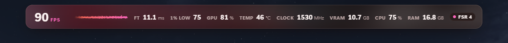
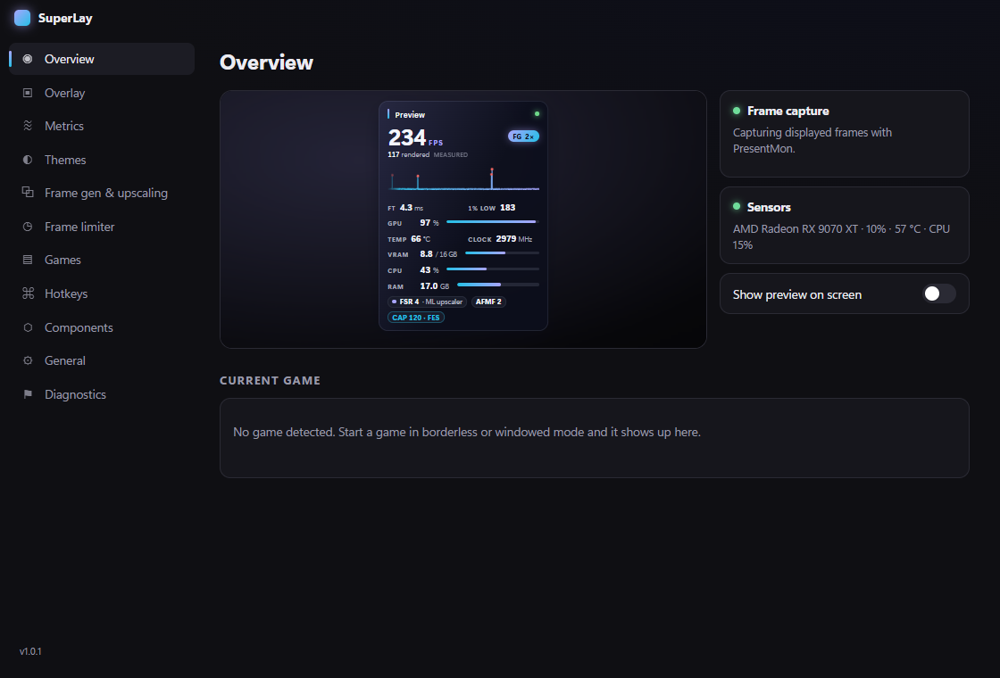
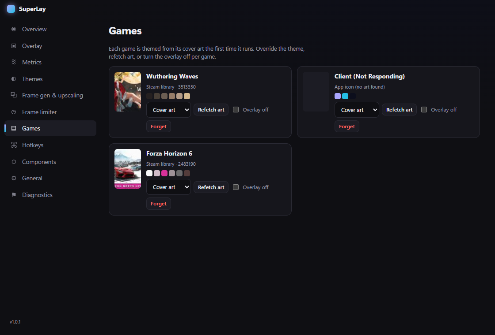
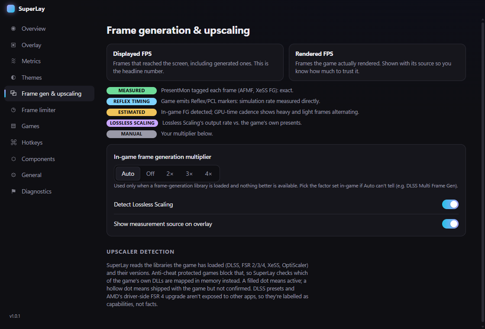
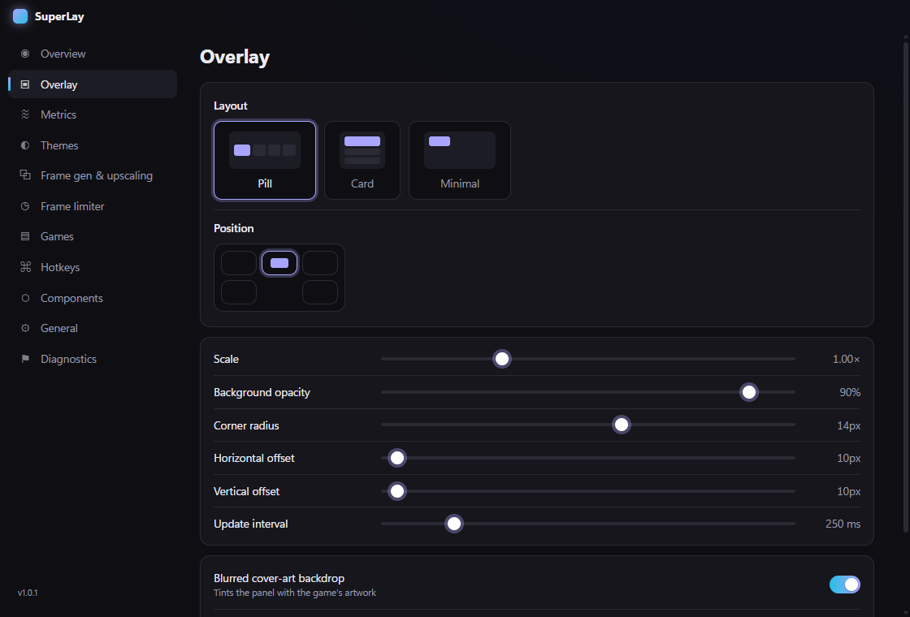
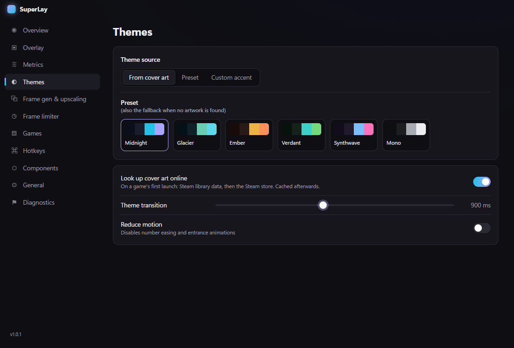
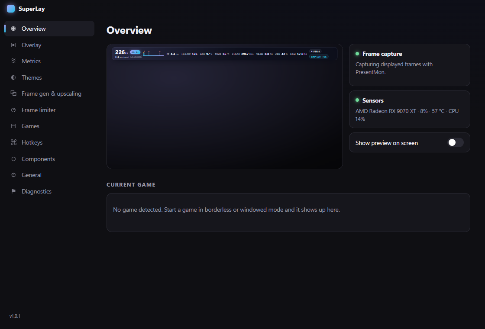
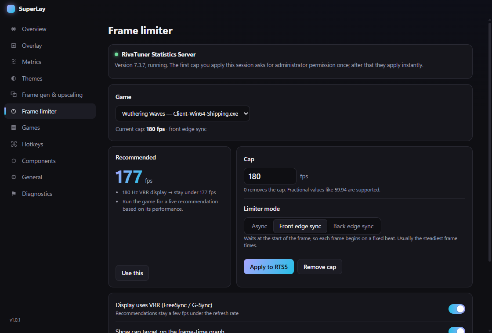

# SuperLay

A minimal performance overlay for Windows games. It themes itself from each game's cover art and reports frame generation correctly.


<sub>Live over Forza Horizon 6. The pink palette and backdrop come from the game's cover art, and FSR 4 is detected as active.</sub>

| Card layout with frame generation | Per-game themes from cover art |
|---|---|
|  |  |
| **Frame gen and upscaling: every number shows its source** | **Overlay layout, position and sizing** |
|  |  |
| **Theme presets and cover-art mode** | **Pill layout (default)** |
|  |  |

Regenerate the settings screenshots with `npm run shots`.

## Install

Download `SuperLay-Setup-x.y.z.exe` (or the portable `.exe`) from [Releases](https://github.com/Shiverbolt/SuperLay/releases/latest). The build isn't code-signed yet, so Windows SmartScreen may warn: choose **More info → Run anyway**.

## Build from source

```
npm install
npm start          # run
npm test           # frame-statistics tests
npm run dist       # installer + portable exe in dist/
```

SuperLay runs from the tray. Open settings by clicking the tray icon or pressing **Alt+Shift+S**.

### Components

**Settings → Components** installs and updates the programs SuperLay works with:

| Component | Needed for | Installed from |
|---|---|---|
| **PresentMon** (required) | FPS, frame times, frame-generation reporting | Intel's GitHub releases, into SuperLay's data folder |
| **RTSS** (optional) | Frame limiter | Guru3D's package via Windows Package Manager (winget), checksum-verified |

Frame capture works without admin if your account is in *Performance Log Users*; otherwise use **Diagnostics → Relaunch as administrator**.

| Hotkey | Action |
|---|---|
| Alt+Shift+O | Show / hide overlay |
| Alt+Shift+L | Cycle layout (pill → card → minimal) |
| Alt+Shift+S | Settings |

## How frame generation is reported

Most overlays count *presents*, so FG either doesn't show or gets double-counted. SuperLay shows two numbers:

- **Displayed FPS**: frames that actually changed the screen (`MsBetweenDisplayChange`), including generated frames. Dropped frames aren't counted.
- **Rendered FPS**: real game frames. Each value is tagged with how it was worked out:
  - **measured**: PresentMon tagged each frame as generated (AMD AFMF, Intel XeSS FG).
  - **reflex timing**: the game emits Reflex/PCL markers, so the simulation rate is measured directly.
  - **estimated**: an FG library is loaded and per-present GPU time splits into heavy (rendered) and light (generated) frames. Several windows must agree before this is trusted.
  - **lossless scaling**: Lossless Scaling's output rate compared with the game's own present rate.
  - **manual**: a multiplier you set (useful for DLSS Multi Frame Gen).

## Frame limiter (via RTSS)

SuperLay doesn't inject anything into games. It sets per-game caps in [RivaTuner Statistics Server](https://www.guru3d.com/download/rtss-rivatuner-statistics-server-download/), using RTSS's own profile API (the one MSI Afterburner uses), and RTSS does the in-game limiting. RTSS is free; install it separately.

- **Modes:** async, front edge sync and back edge sync. Changes apply live, mid-game.
- **Recommended cap:**
  - starts a few fps under your refresh rate on VRR displays (180 Hz → 177)
  - caps the *base* rate when driver frame generation such as AFMF is on, because that runs after RTSS
  - drops to the frame rate your system actually sustains, so frame times stay flat
- **On the overlay:** a cap chip, the cap's target frame time drawn on the graph, and an optional **Pacing** metric (average frame-to-frame change; lower is smoother).
- **Admin rights:** RTSS stores profiles under Program Files, so applying a cap asks for administrator permission unless SuperLay already runs as admin.



## Upscaler detection

SuperLay reads the game's loaded modules: DLSS (with transformer/CNN generation from the DLL version), DLSS RR/FG, FSR 2/3.1/4 (including AMD's driver FSR 4 `amdxcffx64.dll`), XeSS, XeSS FG and OptiScaler. Anti-cheat protected games block module reads. For those it checks which of the game's own DLLs are mapped as images (a mapped DLL can't be opened for writing), so it still finds the active upscaler without touching the process. DLSS presets and AMD's driver-side FSR 4 upgrade aren't visible to other apps, so they're shown as capabilities.

## Themes

On a game's first launch, SuperLay looks up its cover art. It uses the Steam `appmanifest` if the game is in a Steam library, otherwise a Steam store search, and falls back to the exe icon. It then extracts a palette with k-means in OKLab. Themes are cached in `%APPDATA%\SuperLay\games.json` and can be overridden per game.

## Limits

- Exclusive-fullscreen DX9/DX11 games draw over every desktop window, including this overlay. Use borderless. DX12/Vulkan "fullscreen" is fine.
- GPU temperature and clocks come from the same D3DKMT counters Task Manager uses. AMD doesn't report power there.

## Layout

- `src/main/presentmon.js`: CSV parsing, displayed vs rendered FPS, 1% lows, FG cadence analysis
- `src/main/helper.ps1`: sensors, foreground window, module and mapped-DLL probes (in-box PowerShell + C#)
- `src/main/detect.js`: upscaler / FG library detection
- `src/main/theme.js`: game identification, cover art lookup, palette extraction
- `src/renderer/`: overlay and settings UI
- `test/run.js`: frame statistics tests (`npm test`)
